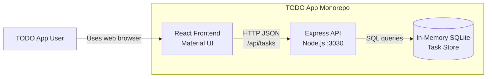
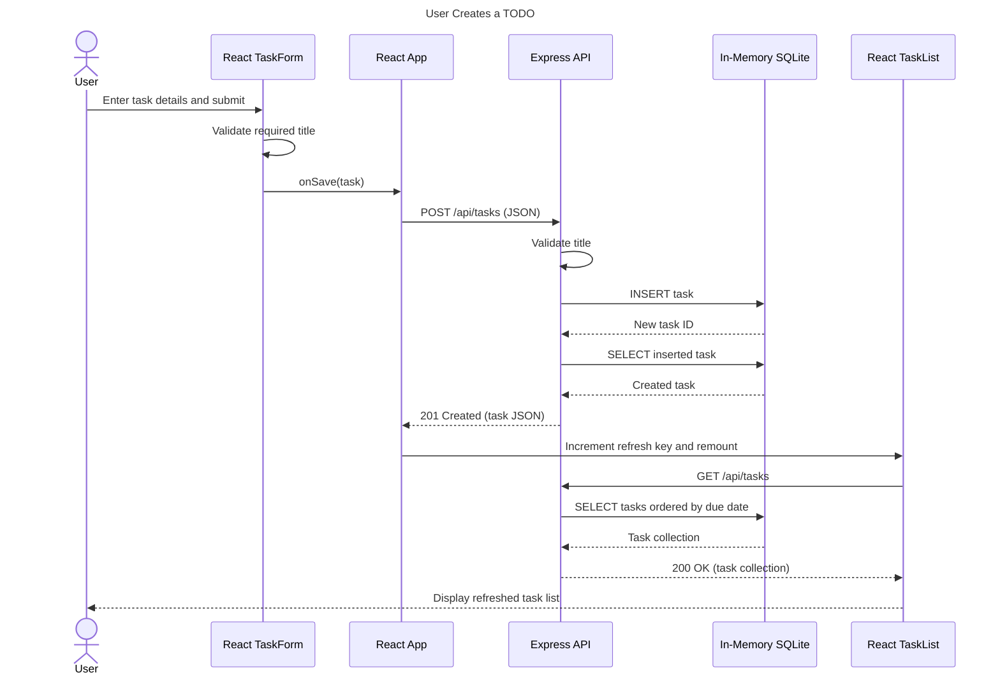

# Cloud Architecture Overview

## Current Architecture

The TODO app is an npm-workspaces monorepo with a React frontend and an Express API. The frontend sends JSON requests to relative `/api/tasks` routes, which the development proxy forwards to the Express server on port `3030`. The API stores tasks in an in-memory SQLite database created with `better-sqlite3`.

The current architecture has no managed cloud services. The data store exists only inside the API process, so all task data is lost when that process restarts.

## System Context

## Sequence: User Creating a TODO

## Runtime Notes

- The root `npm run start` command starts the frontend and backend concurrently.
- The frontend uses the relative `/api/tasks` path and proxies development requests to `http://localhost:3030`.
- Express provides task create, read, update, completion-toggle, and delete endpoints.
- SQLite runs with the `:memory:` connection string; it is not durable or shared across API instances.